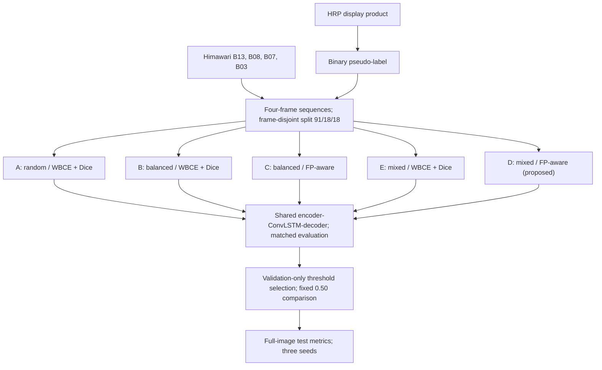
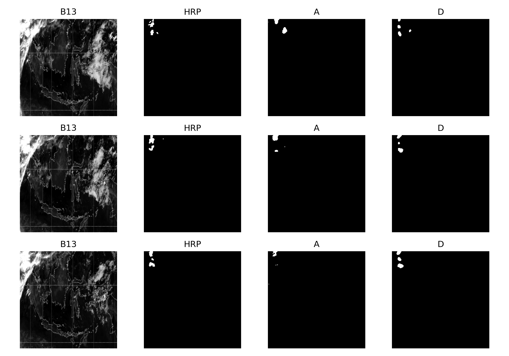

# ST-HRPNet

**Mixed-Sampling and False-Positive-Aware Spatiotemporal Learning for Himawari-Derived Heavy Rainfall Potential Segmentation over Indonesia**

ST-HRPNet integrates mixed patch sampling, false-positive-aware optimization and validation-constrained thresholding within a shared spatiotemporal encoder-decoder for sparse Himawari-derived heavy rainfall potential (HRP) pseudo-label segmentation over Indonesia.

**Research status (27 November 2026): 6/21 runs verified.** Nine B/C/E ablation runs are submitted in an active Kaggle GPU batch; six comparator runs remain pending. Target journal: Journal of the Indian Society of Remote Sensing (Springer); no acceptance or submission is implied.

## Current evaluation: V6

V6 is the current frame-disjoint evaluation protocol. Historical V1–V5 results are preserved separately and must not be pooled with V6.

| Split | Sequences | Positive pixel fraction |
|---|---:|---:|
| Training | 91 | 0.002488 |
| Validation | 18 | 0.003266 |
| Test | 18 | 0.004333 |

From 142 complete timestamps, 139 four-frame windows were archived in V5. V6 removes six irregular training windows and three windows at each adjacent split boundary. The retained 127 windows have no shared time codes or identical processed-frame SHA-256 hashes between splits. This is **not** an event-disjoint or date-diverse evaluation. Targets are extracted from the JMA HRP display product, not independent rainfall observations.

## Research framework and experimental configurations

| Configuration | Sampling | Objective | Verified seeds |
|---|---|---|---|
| A | Random | WBCE + Dice | 42, 123, 2025 |
| B | Balanced 65:35 | WBCE + Dice | Pending (batch active) |
| C | Balanced 65:35 | FP-aware | Pending (batch active) |
| D (proposed) | Mixed 50:50 | FP-aware | 42, 123, 2025 |
| E | Mixed 50:50 | WBCE + Dice | Pending (batch active) |
| B1 | Spatial comparator | Matched protocol planned | Pending |
| B2 | Distinct temporal comparator | Matched protocol planned | Pending |

RQ1: A versus B. RQ2: B versus C. RQ3: C versus D and E versus D (A versus D for the combined strategy). RQ4: fixed versus validation-selected thresholds. Comparator experiments address architectural context; no external architecture superiority is currently established.

## Verified A/D results (three seeds)

Validation-selected thresholds; sample mean ± standard deviation across seeds (n=3).

| Metric | A: random | D: proposed |
|---|---:|---:|
| IoU | 0.2218 ± 0.0520 | 0.3517 ± 0.0615 |
| Dice/F1 | 0.3610 ± 0.0714 | 0.5183 ± 0.0686 |
| Precision | 0.3473 ± 0.0890 | 0.5429 ± 0.0780 |
| Recall | 0.3895 ± 0.1087 | 0.5058 ± 0.1140 |
| MCC | 0.3617 ± 0.0746 | 0.5193 ± 0.0701 |
| Average precision (AP) | 0.3071 ± 0.1003 | 0.4394 ± 0.1175 |

D improves IoU in all three seeds. However, D's AP is lower for seed 42, and mean recall at fixed 0.50 is lower than A. The fixed-threshold comparison is reported in the detailed V6 README. No statistical significance or independent-event skill is claimed.

- [Detailed V6 protocol and results](experiments/V6/README.md)
- [All seed-level results](experiments/V6/ad_all_seeds.csv)
- [Mean and sample SD](experiments/V6/ad_mean_sd.csv)
- [Pilot verification](experiments/V6/pilot/LOCAL_VERIFICATION.json)
- [Repeat verification](experiments/V6/ad_repeat/LOCAL_VERIFICATION.json)

### Qualitative comparison

The panel shows predefined test cases at the validation-selected thresholds. It illustrates localized agreement and errors, not independent meteorological validation.

## Architecture and training

Four multispectral frames, each 256 x 256 x 4, are processed by a time-distributed separable-convolution encoder, ConvLSTM bottleneck and skip-connected decoder. A and D have the same 922,581 parameters. Training uses 128 x 128 patches, 1,800 training patches, 448 shared validation patches, Adam (1e-4), batch 8, up to 40 epochs and early stopping patience 10. GPU runs use mixed float16 with float32 recurrent/output computations. D uses 50% random and 50% positive-centered patches. The loss is 0.60 WBCE + 0.35 Dice + 0.05 FP penalty; no-FP controls use 0.65 WBCE + 0.35 Dice. Thresholds are selected solely on validation images.

## Repository and reproduction

- [V6 executed pilot source and repeat source](experiments/V6/source/)
- [V6 seed-42 outputs](experiments/V6/pilot/)
- [V6 additional-seed outputs](experiments/V6/ad_repeat/)
- [V6 integrity manifest](experiments/V6/SHA256_manifest.csv)
- [Historical experiments and limitations](EXPERIMENT_ARCHIVE.md)
- [Historical notebooks](notebooks/)
- [Historical V5 ablation table](outputs/TAAC_reexperiment_v3/tables/FINAL_clean_ablation_with_mixedpatch.csv)

Clone the repository and install the dependencies in [requirements.txt](requirements.txt). The V6 scripts use the authorized private Kaggle sequence dataset and GPU runtime; they do not run directly without the input archive. Original image arrays and target masks are intentionally not redistributed. Refer to the V6 README for exact artifacts, training protocol and evaluation constraints.

## Limitations and publication status

The HRP target is a satellite-product pseudo-label. V6 removes verified processed-frame overlap but does not establish independent weather events, direct surface rainfall skill, or operational warning performance. Full ablation and independent architecture comparisons remain incomplete. AP is the scikit-learn non-interpolated metric, not interchangeable with historical trapezoidal PR-AUC. V5 and V6 differ in split and training protocol, so their score differences are not attributable solely to overlap removal.

For citation, reference this repository and the specific commit or experiment version. Manuscript author order and bibliographic metadata should follow the approved manuscript; historical submission metadata is not current. See the repository license before reuse.

## Complete V6 benchmark
See [21-run evaluation and limitations](experiments/V6/README.md).
