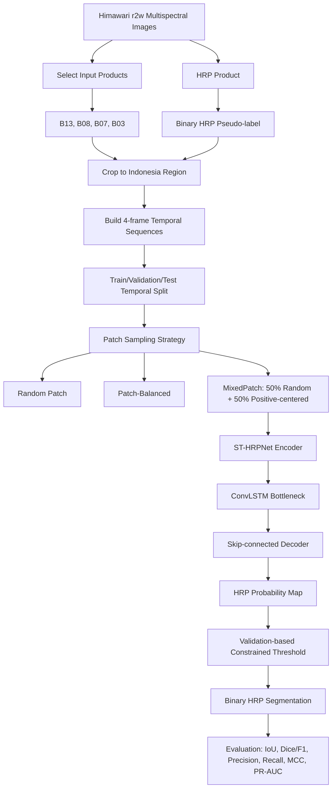
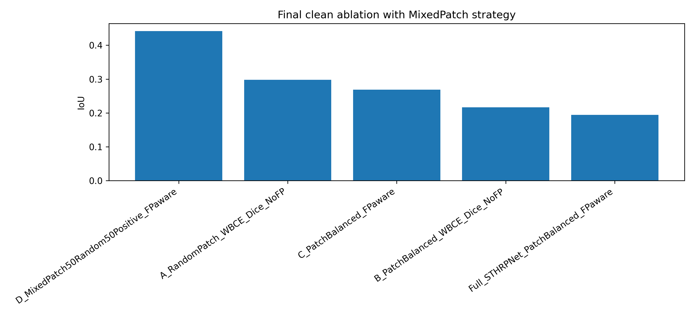
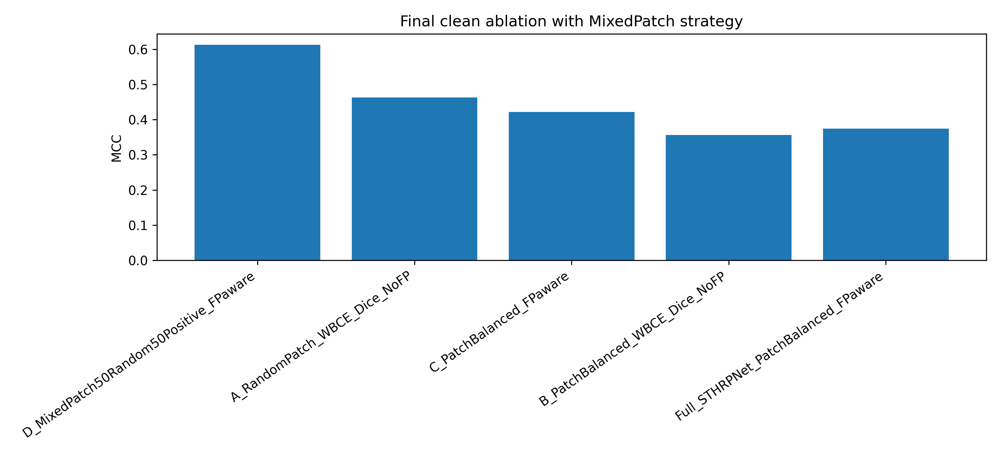
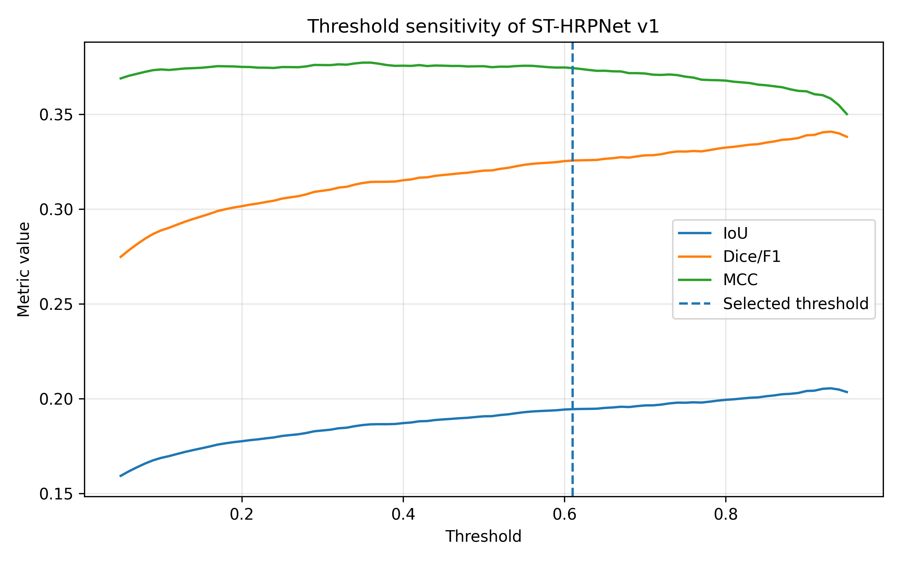
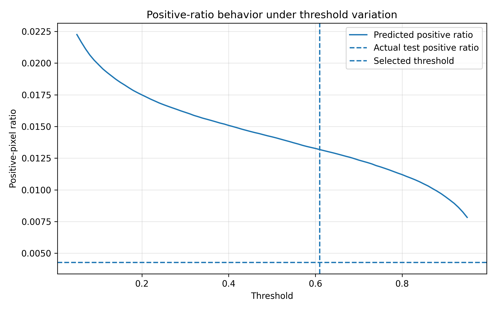

# ST-HRPNet

**Mixed-Sampling and False-Positive-Aware Spatiotemporal Learning for Himawari-Derived Heavy Rainfall Potential Segmentation over Indonesia**

ST-HRPNet is a spatiotemporal deep learning framework for segmenting **Himawari-derived Heavy Rainfall Potential (HRP)** over Indonesia. The framework uses multispectral temporal sequences from Himawari r2w imagery and is designed for sparse HRP patterns, where positive pixels are rare compared with the surrounding background.

The historical V5 experiment archive focuses on **mixed imbalance-aware patch learning**, combining random patches and positive-centered patches with false-positive-aware optimization.

---

## Current V6 validation (2026-11-27)

See [V6 GPU pilot and verified results](experiments/V6/README.md). The 91/18/18 split excludes shared processed frames and irregular temporal windows; event independence remains unverified. Two seed-42 runs are complete; the remaining runs are in progress or pending. Historical V5 results below use a different split and must not be combined with V6. Target journal: Journal of the Indian Society of Remote Sensing (working target, not acceptance).

## Repository

```text
https://github.com/agusperdanawindarto/ST-HRPNet
```

---

## Main Idea

Heavy rainfall potential regions in satellite imagery are usually sparse, spatially localized, and highly imbalanced against large non-HRP background areas. Standard patch learning may either underexpose the model to rare HRP pixels or overfocus on positive areas and lose natural background context.

ST-HRPNet addresses this issue using:

1. **Multispectral Himawari inputs**
2. **Temporal sequence modeling**
3. **Time-distributed spatial encoding**
4. **ConvLSTM bottleneck**
5. **Skip-connected decoding**
6. **Mixed imbalance-aware patch learning**
7. **False-positive-aware loss optimization**
8. **Validation-selected constrained thresholding**

---

## Program Flow



---

## Model Architecture


---

## Final Model Variant

The final selected model is:

```text
D_MixedPatch50Random50Positive_FPaware
```

This model combines:

```text
50% random patches
50% positive-centered patches
Weighted BCE + Dice loss + false-positive-aware penalty
Validation-selected constrained threshold
Full-image test evaluation
```

---

## Dataset Summary

The final experiment uses Himawari-derived HRP pseudo-label segmentation over Indonesia.

| Split      | Number of Sequences | Input Shape            | Target Shape        | Positive Pixel Ratio |
| ---------- | ------------------: | ---------------------- | ------------------- | -------------------: |
| Train      |                  97 | `(97, 4, 256, 256, 4)` | `(97, 256, 256, 1)` |             0.002536 |
| Validation |                  21 | `(21, 4, 256, 256, 4)` | `(21, 256, 256, 1)` |             0.003214 |
| Test       |                  21 | `(21, 4, 256, 256, 4)` | `(21, 256, 256, 1)` |             0.004272 |

---

## Input Products

| Product | Role                                                          |
| ------- | ------------------------------------------------------------- |
| B13     | Infrared cloud-top information                                |
| B08     | Water vapor / atmospheric moisture-related information        |
| B07     | Mid-infrared information                                      |
| B03     | Visible-band spatial cloud structure                          |
| HRP     | Target pseudo-label for heavy rainfall potential segmentation |

---

## Final Ablation Results

| Model                                      | Patch Strategy                         | Loss Setting               | Threshold |        IoU |    Dice/F1 |  Precision |     Recall |        MCC |     PR-AUC | Actual Ratio | Predicted Ratio |
| ------------------------------------------ | -------------------------------------- | -------------------------- | --------: | ---------: | ---------: | ---------: | ---------: | ---------: | ---------: | -----------: | --------------: |
| Full_STHRPNet_PatchBalanced_FPaware        | Patch-balanced                         | WBCE + Dice + FP-aware     |      0.61 |     0.1944 |     0.3256 |     0.2156 |     0.6649 |     0.3744 |     0.2395 |     0.004272 |        0.013176 |
| A_RandomPatch_WBCE_Dice_NoFP               | Random patch                           | WBCE + Dice                |      0.60 |     0.2979 |     0.4591 |     0.3937 |     0.5504 |     0.4628 |     0.3807 |     0.004272 |        0.005972 |
| B_PatchBalanced_WBCE_Dice_NoFP             | Patch-balanced                         | WBCE + Dice                |      0.05 |     0.2167 |     0.3562 |     0.4034 |     0.3189 |     0.3563 |     0.2438 |     0.004272 |        0.003377 |
| C_PatchBalanced_FPaware                    | Patch-balanced                         | WBCE + Dice + FP-aware     |      0.05 |     0.2689 |     0.4238 |     0.4241 |     0.4235 |     0.4214 |     0.3434 |     0.004272 |        0.004266 |
| **D_MixedPatch50Random50Positive_FPaware** | **50% random + 50% positive-centered** | **WBCE + Dice + FP-aware** |  **0.05** | **0.4420** | **0.6131** | **0.5727** | **0.6596** | **0.6128** | **0.5565** | **0.004272** |    **0.004921** |

---

## Key Finding

The final experiment shows that full patch-balanced learning alone is not optimal for sparse HRP segmentation. Random patch learning provides stronger natural background representation, but it still performs below the final mixed-patch strategy.

The best result is obtained by combining random background exposure and positive-centered rare-pattern learning:

```text
MixedPatch 50% Random + 50% Positive-centered + FP-aware Loss
```

This confirms that the proposed framework should be described as an:

```text
imbalance-aware spatiotemporal deep learning framework
```

rather than a simple patch-balanced model.

---

## Main Figures

### 1. Final Ablation Comparison by IoU



### 2. Final Ablation Comparison by MCC



### 3. Threshold Sensitivity



### 4. Positive Ratio under Threshold Variation



### 5. Event-based HRP Segmentation Cases

Example event-case figures are stored in:

```text
outputs/TAAC_reexperiment_v3/figures/
```

Recommended figure files:

```text
event_case_*.png
```

Use the following format if the event figures are uploaded to the repository:

```markdown


```

---

## Suggested Repository Structure

```text
ST-HRPNet/
├── README.md
├── notebooks/
│   ├── FINAL_ST_HRPNet_TAAC_Robust_ReExperiment_V5_LAST.ipynb
│   └── ST_HRPNet_TAAC_Extended_Experiments_CHECKPOINT_FIXED.ipynb
├── src/
│   ├── data_preparation.py
│   ├── model_st_hrpnet.py
│   ├── losses.py
│   ├── metrics.py
│   ├── train.py
│   └── evaluate.py
├── outputs/
│   └── TAAC_reexperiment_v3/
│       ├── tables/
│       │   ├── dataset_integrity_report.csv
│       │   ├── main_model_re_evaluation_fair_threshold.csv
│       │   ├── fair_ablation_study_results.csv
│       │   ├── FINAL_clean_ablation_with_mixedpatch.csv
│       │   └── FINAL_title_and_novelty_decision.json
│       ├── figures/
│       │   ├── FINAL_clean_ablation_with_mixedpatch_iou.png
│       │   ├── FINAL_clean_ablation_with_mixedpatch_mcc.png
│       │   ├── threshold_sensitivity_metrics.png
│       │   ├── threshold_sensitivity_positive_ratio.png
│       │   └── event_case_*.png
│       ├── models/
│       └── cache/
├── external_precip_validation/
│   └── README_precip_validation.txt
├── requirements.txt
└── LICENSE
```

---

## How to Run

### 1. Clone Repository

```bash
git clone https://github.com/agusperdanawindarto/ST-HRPNet.git
cd ST-HRPNet
```

### 2. Create Environment

```bash
python -m venv venv
venv\Scripts\activate
```

For Linux or macOS:

```bash
python -m venv venv
source venv/bin/activate
```

### 3. Install Requirements

```bash
pip install -r requirements.txt
```

Suggested requirements:

```text
tensorflow
numpy
pandas
matplotlib
scikit-learn
opencv-python
pillow
tqdm
beautifulsoup4
requests
openpyxl
```

### 4. Run Notebook

Open Jupyter Notebook or VS Code and run:

```text
notebooks/FINAL_ST_HRPNet_TAAC_Robust_ReExperiment_V5_LAST.ipynb
```

Recommended execution order:

```text
Cell 1  : Imports and environment
Cell 2  : Main configuration
Cell 4B : Load checkpoint
Cell 5  : Dataset integrity check
Cell 6  : Metrics and threshold selection
Cell 7  : Exact ST-HRPNet architecture
Cell 8B : Force load ST-HRPNet model
Cell 9  : Main model re-evaluation
Cell 10 : Threshold sensitivity
Cell 11 : Ablation helper functions
Cell 12A: Reset old A/B/C weights
Cell 12 : Fair ablation study
Cell 12B: Final MixedPatch ablation and title decision
Cell 13 : Optional external precipitation validation
Cell 14 : Event-based case visualization
Cell 15 : Export manuscript-ready summary
```

---

## Final Decision Rule

The final notebook automatically determines whether the title should retain the term **imbalance-aware**.

Decision rule:

```text
If D_MixedPatch50Random50Positive_FPaware is the best model,
or if D is very close to RandomPatch while maintaining realistic positive ratio,
then retain the title with "imbalance-aware".
```

Final decision from the latest experiment:

```text
KEEP_IMBALANCE_AWARE_TITLE
```

Recommended title:

```text
Himawari-derived heavy rainfall potential segmentation over Indonesia using an imbalance-aware spatiotemporal deep learning framework
```

---

## Output Files

After running the final experiment, check:

```text
outputs/TAAC_reexperiment_v3/FINAL_TITLE_DECISION_README.txt
outputs/TAAC_reexperiment_v3/tables/FINAL_clean_ablation_with_mixedpatch.csv
outputs/TAAC_reexperiment_v3/tables/FINAL_title_and_novelty_decision.json
outputs/TAAC_reexperiment_v3/figures/FINAL_clean_ablation_with_mixedpatch_iou.png
outputs/TAAC_reexperiment_v3/figures/FINAL_clean_ablation_with_mixedpatch_mcc.png
```

---

## Notes on External Precipitation Validation

External precipitation validation is prepared as an optional module. It is only executed if an external precipitation mask is available in:

```text
external_precip_validation/precip_test_masks_256.npy
```

If this file is not available, the manuscript should not claim independent validation with GPM, GSMaP, radar, or rain-gauge observations. This should be reported as a limitation and future work.

---

## Scientific Scope

This project focuses on:

```text
Himawari-derived HRP pseudo-label segmentation
```

It does not directly estimate quantitative rainfall intensity. The output should be interpreted as a binary segmentation of satellite-derived heavy rainfall potential patterns.

---

## Recommended Manuscript Contribution

The recommended contribution statement is:

```text
This study proposes an imbalance-aware spatiotemporal deep learning framework for Himawari-derived heavy rainfall potential segmentation over Indonesia. The framework integrates multispectral temporal encoding, ConvLSTM-based temporal representation learning, skip-connected decoding, mixed patch learning, false-positive-aware optimization, and validation-constrained threshold selection.
```

---

## Citation

If this repository supports your work, please cite:

```bibtex
@article{windarto2026sthrpnet,
  title={Himawari-derived heavy rainfall potential segmentation over Indonesia using an imbalance-aware spatiotemporal deep learning framework},
  author={Windarto, Agus Perdana and Wang, Junhai and Mesran and Watrianthos, Ronal},
  journal={Submitted to Theoretical and Applied Climatology},
  year={2026}
}
```

---

## Authors

```text
Agus Perdana Windarto
Junhai Wang
Mesran
Ronal Watrianthos
```

---

## License

This repository is intended for academic and research purposes. Please check the license file before reuse, redistribution, or modification.

---

## Disclaimer

The HRP target used in this project is derived from satellite-based Himawari products and should be treated as a pseudo-label for heavy rainfall potential segmentation. The model output is not a direct rainfall measurement and should not be used as an operational warning system without further independent validation using ground-based, radar-based, or precipitation retrieval datasets.

## Experiment archive (2026-11-27)

See [experiment archive and limitations](EXPERIMENT_ARCHIVE.md), [notebooks](notebooks/), [final ablation CSV](outputs/TAAC_reexperiment_v3/tables/FINAL_clean_ablation_with_mixedpatch.csv), [figures](outputs/TAAC_reexperiment_v3/figures/), [model weights](outputs/TAAC_reexperiment_v3/models/) and [split metadata](taac_checkpoints_v3/). Historical author/submission metadata requires confirmation. The repository is an archive, not a claim of independent rainfall validation.
