# ST-HRPNet

**Sampling, Loss and Architecture Trade-offs in Himawari-Derived Heavy Rainfall Potential Segmentation over Indonesia**

A retrospective empirical study of sparse heavy rainfall potential (HRP) pseudo-label segmentation using Himawari multispectral display imagery. ST-HRPNet (configuration D) combines mixed patch sampling and false-positive-aware optimization within a shared spatiotemporal backbone. The study evaluates the benefits and limitations of these choices rather than claiming universal architectural superiority.

**Research status — 28 November 2026:** all **21/21 training runs** completed and numerically verified (seven configurations × three seeds); nine manuscript figures and three supplementary visualizations archived. Target journal: *Journal of the Indian Society of Remote Sensing* (Springer). No submission, acceptance or peer-review outcome is implied.

[Complete benchmark](experiments/V6/README.md) · [Figure archive](paper_figures/README.md) · [Run-level results](experiments/V6/all_21_runs.csv) · [Verified scene-level results](paper_figures/per_scene_verified.csv)

## 1. Dataset and partition

| Component | Specification |
|---|---|
| Source | JMA Himawari r2w display imagery; Indonesia crop (approximately 95–141°E, 6°N–11°S) |
| Input channels | B13, B08, B07, B03 |
| Target | Binary HRP pseudo-label extracted from the display product at the final frame |
| Temporal input | Four consecutive observations at 10-minute intervals |
| Data archive | 852 image files, 142 complete timestamps, 139 candidate sequences |
| Model input / training patch | 256 × 256 full image / 128 × 128 patch |
| Retained sequences | 127 |

| Partition | Sequences | Positive-pixel fraction |
|---|---:|---:|
| Training | 91 | 0.002488 |
| Validation | 18 | 0.003266 |
| Test | 18 | 0.004333 |

The frame-disjoint chronological protocol excludes six irregular training windows and six boundary-overlap windows. Acquisition time codes and processed-frame SHA-256 hashes show no shared processed input frames across partitions. The data still originate from a single acquisition archive, not independent weather events or dates.

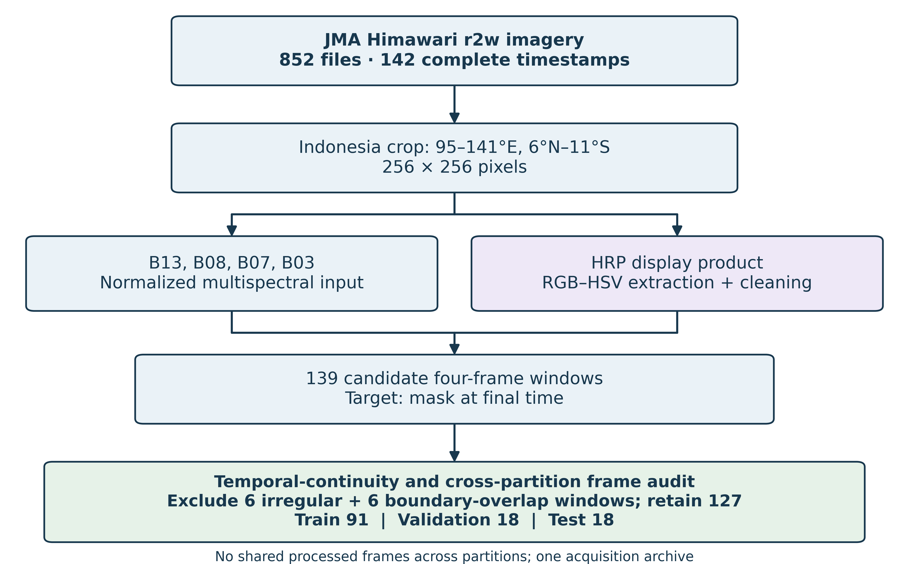

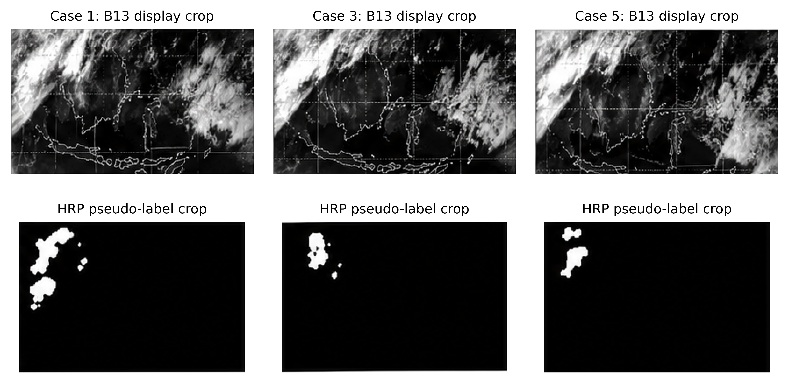

Figure 2 illustrates archived inputs, not test performance.

## 2. Research framework and configurations

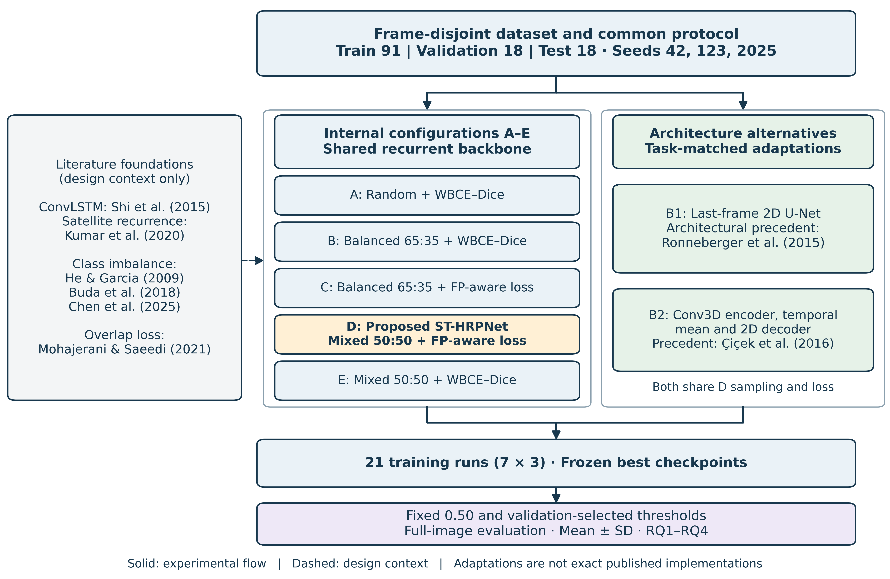

The literature provides architectural and methodological context. Ronneberger et al. (2015), Çiçek et al. (2016) and Shi et al. (2015) motivate the 2D U-Net, volumetric convolution and ConvLSTM components, respectively. B1 and B2 are task-matched adaptations, not exact reproductions of published networks.

| Configuration | Architecture | Sampling | Objective | Seeds verified |
|---|---|---|---|---:|
| A | Shared recurrent backbone | Random | WBCE + Dice | 3/3 |
| B | Shared recurrent backbone | Balanced 65:35 | WBCE + Dice | 3/3 |
| C | Shared recurrent backbone | Balanced 65:35 | FP-aware | 3/3 |
| D — ST-HRPNet | Shared recurrent backbone | Mixed 50:50 | FP-aware | 3/3 |
| E | Shared recurrent backbone | Mixed 50:50 | WBCE + Dice | 3/3 |
| B1 | Last-frame 2D U-Net | Mixed 50:50 | FP-aware | 3/3 |
| B2 | Conv3D encoder, temporal mean, 2D decoder | Mixed 50:50 | FP-aware | 3/3 |

Seeds: 42, 123, 2025. B/C share training patch manifests per seed; D/E/B1/B2 share matched mixed-sampling manifests. All configurations use the same retained partitions.

## 3. ST-HRPNet architecture and optimization

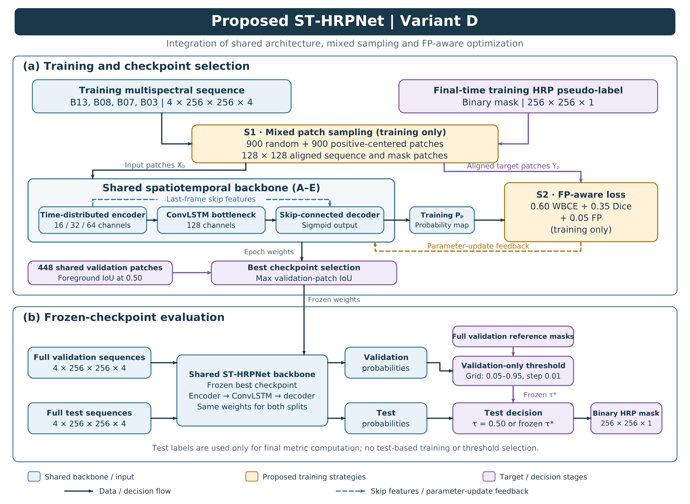

The recurrent backbone employs a time-distributed separable-convolution encoder (16/32/64 channels), a 128-channel ConvLSTM bottleneck, and a skip-connected decoder using final-frame encoder features. The evaluated strategies are S1: mixed sampling (900 random and 900 positive-centered patch draws), and S2: FP-aware composite loss (0.60 WBCE + 0.35 Dice + 0.05 FP). No-FP controls use 0.65 WBCE + 0.35 Dice.

Training uses 1,800 patches, 448 common validation patches, Adam (learning rate 0.0001), global batch size 8, up to 40 epochs, early-stopping patience 10 and two Tesla T4 GPUs with mixed float16 and float32 outputs (also float32 recurrence in ST-HRPNet). Checkpoints and thresholds are selected using validation data only. Test evaluation uses frozen checkpoints at fixed 0.50 and validation-selected thresholds.

## 4. Complete experimental results

Validation-selected operating points; mean ± sample SD across three seeds for IoU, Dice/F1 and AP. Precision, recall and false-positive rate (FPR) are means.

| Model | IoU | Dice/F1 | AP | Precision | Recall | FPR |
|---|---:|---:|---:|---:|---:|---:|
| A | 0.2218 ± 0.0520 | 0.3610 ± 0.0714 | 0.3071 ± 0.1003 | 0.3473 | 0.3895 | 0.00332 |
| B | 0.3218 ± 0.0630 | 0.4847 ± 0.0710 | 0.3984 ± 0.0454 | 0.5428 | 0.4524 | 0.00168 |
| C | 0.3197 ± 0.0536 | 0.4829 ± 0.0613 | 0.4080 ± 0.0295 | 0.5643 | 0.4299 | 0.00145 |
| D | 0.3517 ± 0.0615 | 0.5183 ± 0.0686 | 0.4394 ± 0.1175 | 0.5429 | 0.5058 | 0.00190 |
| E | 0.3513 ± 0.0608 | 0.5179 ± 0.0684 | 0.4505 ± 0.0792 | 0.5383 | 0.5045 | 0.00187 |
| B1 | 0.4228 ± 0.0801 | 0.5913 ± 0.0818 | 0.5770 ± 0.0729 | 0.5540 | 0.6350 | 0.00220 |
| B2 | 0.3423 ± 0.0417 | 0.5091 ± 0.0457 | 0.4097 ± 0.0925 | 0.4765 | 0.5468 | 0.00260 |

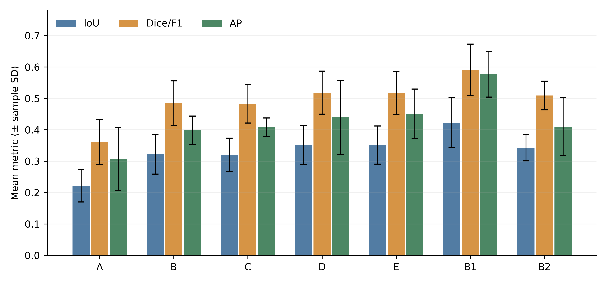

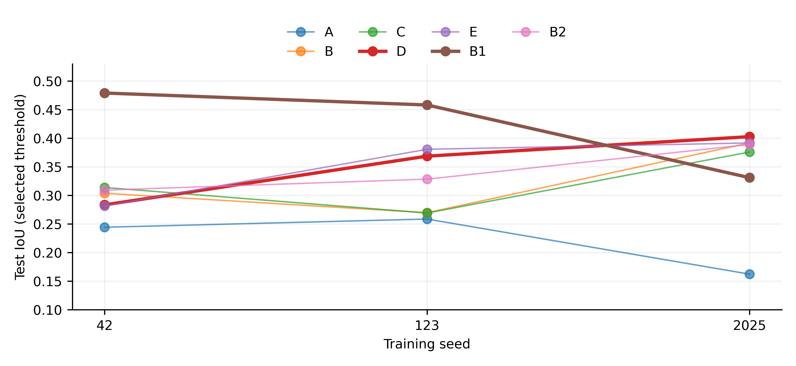

### Research questions and empirical findings

| RQ | Evidence | Finding |
|---|---|---|
| RQ1 — Sampling | A/B/E and C/D | B improves mean IoU over A by 0.1000; E improves it by 0.1296. D exceeds C by 0.0320. The optimal mixture is not established. |
| RQ2 — Loss | B/C and E/D | C reduces FPR relative to B, with slightly lower IoU. D/E differ by only 0.00034 in mean selected IoU; E has higher AP. FP-aware overlap gains are not robust across seeds. |
| RQ3 — Architecture | D/B1/B2 | B1 has the highest mean IoU (0.4228), Dice/F1 (0.5913) and AP (0.5770). D slightly exceeds B2 in mean selected IoU. These comparisons do not isolate temporal information alone. |
| RQ4 — Decision threshold | Fixed 0.50 vs validation-selected | Validation-selected thresholds lower mean FPR, recall and IoU for every configuration under this criterion. |

The proposed ST-HRPNet does not outperform the adapted 2D U-Net. This negative result is part of the scientific contribution, not an excluded experiment.

### Observed training cost

| Model | Parameters | Mean epochs | Mean fit time (s) | Mean seconds/epoch |
|---|---:|---:|---:|---:|
| D | 922,581 | 18.67 | 487.77 | 26.35 |
| B1 | 489,553 | 18.33 | 253.99 | 13.86 |
| B2 | 1,075,921 | 24.00 | 657.37 | 27.38 |

B1 has approximately 46.9% fewer parameters than D. Fit time is descriptive training wall time, not inference latency or FLOPs.

### Operating-point sensitivity

| Model | IoU (fixed / selected) | Recall (fixed / selected) | FPR (fixed / selected) |
|---|---:|---:|---:|
| A | 0.2413 / 0.2218 | 0.6109 / 0.3895 | 0.00670 / 0.00332 |
| B | 0.3553 / 0.3218 | 0.5615 / 0.4524 | 0.00242 / 0.00168 |
| C | 0.3540 / 0.3197 | 0.5087 / 0.4299 | 0.00187 / 0.00145 |
| D | 0.3734 / 0.3517 | 0.5696 / 0.5058 | 0.00228 / 0.00190 |
| E | 0.3535 / 0.3513 | 0.5201 / 0.5045 | 0.00206 / 0.00187 |
| B1 | 0.4349 / 0.4228 | 0.7710 / 0.6350 | 0.00345 / 0.00220 |
| B2 | 0.3452 / 0.3423 | 0.5707 / 0.5468 | 0.00281 / 0.00260 |

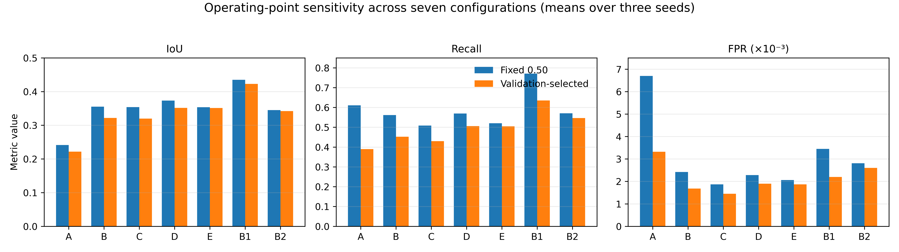

AP is non-interpolated average precision, independent of the binary decision threshold; it is not necessarily equivalent to trapezoidal PR-AUC.

## 5. Qualitative test predictions and scene-level audit

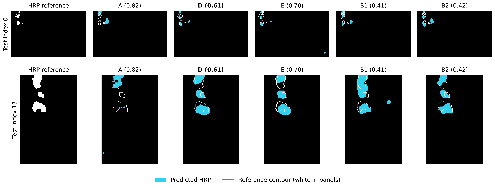

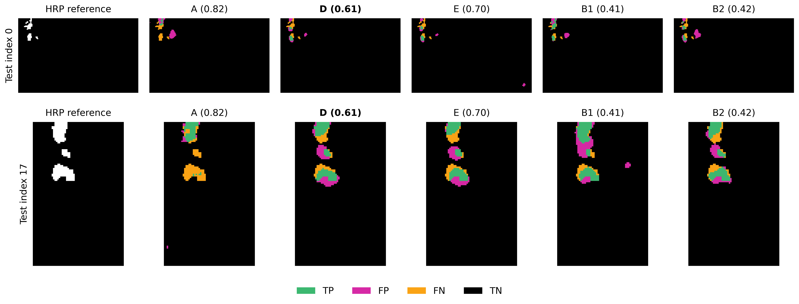

Figures 7–8 show test indices 0 and 17, seed 42, for A, D, E, B1 and B2. They were regenerated directly from archived probabilities and reference masks, with the same crop rule and displayed configurations as the Word manuscript. They are matched replacements, not byte-identical copies of its current images.

### Supplementary figures

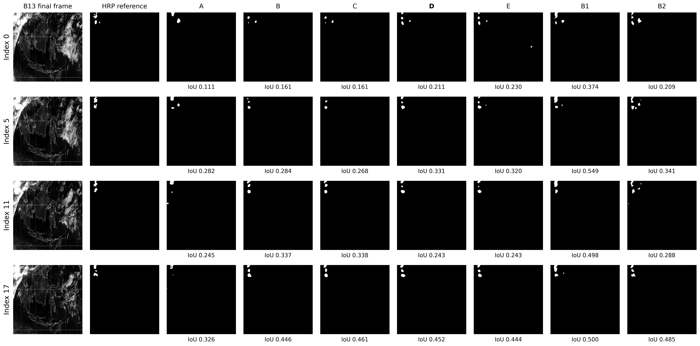

S1 includes processed final-frame B13 input, HRP reference, all seven predicted masks and per-image IoU at indices 0, 5, 11, 17 (seed 42), selected by spacing rather than performance.

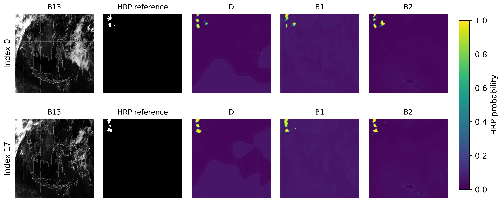

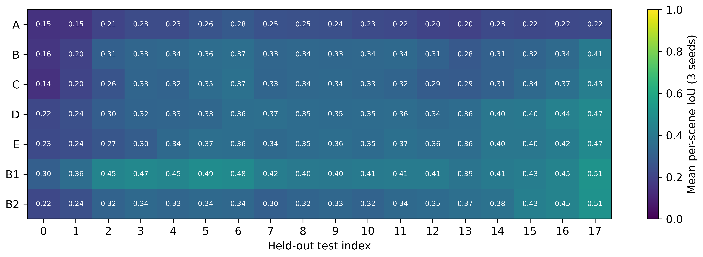

The supplementary audit recomputes TP, FP, FN, TN and IoU from prediction arrays for 378 model/seed/scene combinations (7 × 3 × 18). Confusion counts match the archived pooled and per-scene results. Undefined IoU for an empty union is recorded as NA. The scenes are temporally correlated; these are descriptive results, not 378 independent weather events.

- [All nine figures, captions and supplementary material](paper_figures/README.md)
- [Verified per-scene CSV](paper_figures/per_scene_verified.csv)
- [Figure integrity manifest](paper_figures/SHA256_manifest.csv)

## 6. Reproducibility and repository layout

| Location | Contents |
|---|---|
| [experiments/V6](experiments/V6/README.md) | Complete frame-disjoint benchmark (internal protocol version identifier) |
| [source](experiments/V6/source/) | Executed experimental source and kernel metadata |
| [pilot](experiments/V6/pilot/) | A/D seed-42 outputs |
| [ad_repeat](experiments/V6/ad_repeat/) | A/D additional-seed outputs |
| [bce](experiments/V6/bce/) | B/C/E ablation outputs |
| [comparators](experiments/V6/comparators/) | B1/B2 outputs |
| [paper_figures](paper_figures/) | Nine manuscript figures, supplementary figures, per-scene results and captions |
| [Historical archive](EXPERIMENT_ARCHIVE.md) | Earlier exploratory protocols, excluded from the current benchmark |
| [notebooks](notebooks/) | Historical notebooks |

**Numerical evidence:** [all 21 runs](experiments/V6/all_21_runs.csv), [mean and SD](experiments/V6/all_21_mean_sd.csv), [paired seed differences](experiments/V6/paired_seed_iou_differences.csv), [training efficiency](experiments/V6/training_efficiency.csv), [artifact SHA-256 manifest](experiments/V6/SHA256_manifest.csv).

Each batch includes model weights, training histories, patch manifests, thresholds, prediction probabilities, per-scene metrics and numerical verification records. Reproduction requires authorized access to the private sequence dataset and compatible GPU runtime. Install the dependencies in [requirements.txt](requirements.txt) and consult the executed source and [protocol documentation](experiments/V6/README.md). Raw tensors, standalone reference masks and credentials are not publicly redistributed.

Kaggle notebooks: [pilot](https://www.kaggle.com/code/niluhwiwiksrirahayu/st-hrpnet-v6-gpu-pilot), [A/D repeats](https://www.kaggle.com/code/niluhwiwiksrirahayu/st-hrpnet-v6-gpu-ad-repeat), [B/C/E](https://www.kaggle.com/code/niluhwiwiksrirahayu/st-hrpnet-v6-gpu-bce-ablation), [B1/B2](https://www.kaggle.com/code/niluhwiwiksrirahayu/st-hrpnet-v6-gpu-comparators). Private resources require permission.

## 7. Limitations and publication status

The target is a satellite-display pseudo-label, not measured surface rainfall. The protocol excludes shared processed frames across partitions but does not establish independent-event/date generalization. Three seeds characterize training variability; they do not establish statistical significance or meteorological skill. The sampling/loss design is not fully factorial, and architecture comparisons change capacity and operators together. Synchronized inference latency and FLOPs are not reported. Source imagery redistribution rights and a fully anonymized reproduction package remain unverified.

Earlier experimental versions use different splits and optimization settings and must not be pooled with this benchmark. Version identifiers are retained only for repository traceability. The unpublished manuscript is not included. Cite the specific repository commit and approved manuscript metadata when available; consult the repository license before reuse.
